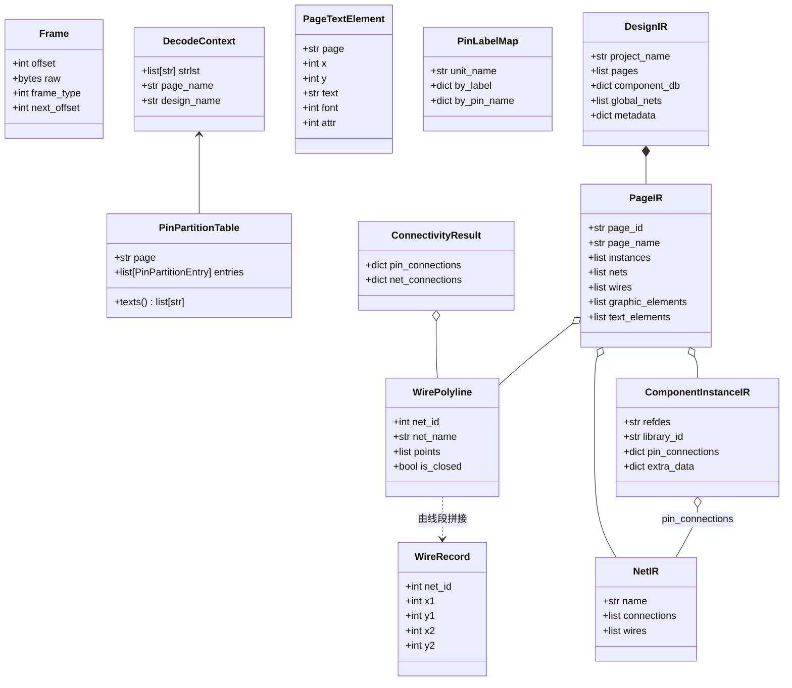
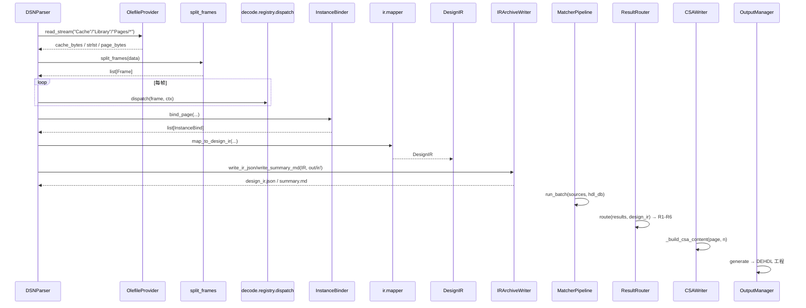

# ARCHITECTURE（系统架构与设计总文档）

> 文档元信息
> - 编号：CORE-ARCH；版本：v5.0（2026-09-01 mentor 交接改造）
> - 角色：系统架构全集（DSN 解析器 + 转换管线 + 匹配 + mock + 输出 + Cadence 校验链 + 接口契约 + 遗留代码）
> - 当前基线：698 passed / 21 skipped / 0 failed；参考基准比对 all_passed=True；SPCOCD-553 待实测确认；五层校验链全对齐
> - 关联：MATCHING.md（匹配专项）/ STATUS.md（当前状态）/ ROADMAP.md（路线图）
> - 交接说明：本文档供接手开发人员阅读
> - 历史注记：本文档由历史文档整合而来，历史原件见 docs/archive/（00-core-pre-consolidation/ 与 legacy-pluginver-docs/）

---

## Part 0 文档说明

### 0.1 文档定位

本文档为系统架构与设计总文档，覆盖：DSN 解析器六层管道、转换管线 Stage1-6、匹配与六类路由、mock 1:1 复刻、DEHDL 输出、Cadence 加载校验链、接口契约与数据承载、插件化与前端、遗留代码说明。历史文档整合来源见 docs/archive/。

### 0.2 Part 结构总表

| Part | 内容 |
|---|---|
| Part I | 系统架构总览（分层/IR/模块/部署） |
| Part II | DSN 解析器架构（六层管道/注册表/帧序/解析能力基线/DSN 格式事实） |
| Part III | 转换管线（Stage1-6/路由/继承/mock/走线直通） |
| Part IV | 输出与 Cadence 校验链（输出结构/五层校验链/输出包结构） |
| Part V | 接口契约与数据承载（融合附录-A） |
| Part VI | 插件化与前端 |
| Part VII | 遗留代码与退役模块（_retired/） |
| Part VIII | 附录（类图/时序图/术语/参考基准） |

### 0.3 当前口径

- DSN 唯一信息源；EXP 仅对拍辅助（参考基准比对），不以推断数据替代源数据；
- IR 核心归档 schema 归上游 parser（R-IRJSON），下游只消费 + 派生视图层 CSV；
- hdl_lib 只读资产；R1/R2 继承写实例不写库；
- mock 库名配置驱动：cis2hdl/config/routing.yaml temp_lib.lib_name（当前 TG0C0D2_VB_lib）；
- 零 origin 库（audit 检查）；
- SPCOCD-553 当前状态：待实测确认（详见 STATUS §3）。

---

## Part I 系统架构总览

### 1. 整体架构图

```
┌──────────────────────────────────────────────────────────────────────┐
│  DSN 文件（OLE2/CFBF 复合文档，TG0C0D2_VER_B_SCH.DSN）                │
└──────────────────────────────┬───────────────────────────────────────┘
                               ▼
┌──────────────────────────────────────────────────────────────────────┐
│  Stage 1+2  DSN 解析（plugin_ver 只读上游交付物）                     │
│   DSNParser.parse(Path) → DesignIR（六层管道：io→frame→strlst→decode  │
│   →bind→ir；OleReader/BinaryReader/DSN Structure Parsers）            │
└──────────────────────────────┬───────────────────────────────────────┘
                               ▼
┌──────────────────────────────────────────────────────────────────────┐
│  Stage 3  中间文件层（IR 核心归档 + 下游视图层）                      │
│   上游：ir_dump（R-IRJSON）→ design_ir.json + summary.md             │
│   下游：ir_load 消费 + 视图层 CSV（components/nets/pins，net_id 回填） │
└──────────────────────────────┬───────────────────────────────────────┘
                               ▼
┌──────────────────────────────────────────────────────────────────────┐
│  Stage 4  匹配层（core/matcher/）                                     │
│   source_builder.build(design_ir) → list[ComponentDef]               │
│   MatcherPipeline.run_batch(sources, hdl_db) → list[MatchResult]     │
│   result_router.route(results, design_ir) → RoutedPlan（R1-R6）      │
└──────────────────────────────┬───────────────────────────────────────┘
                               ▼
┌──────────────────────────────────────────────────────────────────────┐
│  Stage 5  符号组装层（core/writer/）                                  │
│   mock_rebuilder / dsn_geometry / text_element_writer /              │
│   source_symbol_writer / gnd_placement / inherit_writer              │
│   → TG0C0D2_VB_lib（mock 191 cell）+ 页面指令                         │
└──────────────────────────────┬───────────────────────────────────────┘
                               ▼
┌──────────────────────────────────────────────────────────────────────┐
│  Stage 6  输出层（CSAWriter + OutputManager + 插件）                  │
│   → DEHDL 工程：hdl_lib + TG0C0D2_VB_lib + worklib + cpm/cds.lib     │
│     + bom/ + ir/（对齐 s16 参考包，Cadence 16.6 可加载）              │
└──────────────────────────────────────────────────────────────────────┘
```

### 2. 分层设计

| 层 | 职责 | 关键模块 | 状态 |
|---|---|---|---|
| Parser Layer | DSN 二进制解析 → IR | core/parser/dsn/**（55 文件，六层管道） | 只读复用（上游交付物） |
| Matcher Layer | 两阶段匹配 + 六类路由 | core/matcher/（pipeline/source_builder/result_router/passive/active/type_gate） | 已实现 |
| Validator Layer | 输出后校验 | core/qa/（golden_verify/route_preview/conversion_report） | 已实现 |
| Writer Layer | DEHDL 输出 | core/writer/（csa_writer/mock_rebuilder/dsn_geometry/output_manager 等 30 个） | 已实现 |
| Version Adapter Layer | 版本适配 | 规划未实施 | 待确认 |
| Layout Layer | 排版美化 | gnd_cluster_planner（降级为可选插件）/ astar_router（默认不执行） | 可选 |
| Diagnostics Layer | 诊断/质量估计 | core/diagnostics/** | 复用 |

### 3. 中间表示模型 IR

核心数据模型（Pydantic v2）：

```python
# ir/component.py —— 元件实例（匹配与输出的核心契约）
class ComponentInstanceIR(BaseModel):
    refdes: str
    library_id: str = ""          # shape / 匹配后的 hdl_lib 元件名
    section: int = 1              # 多单元（U7A-F）段号
    loc_x: int = 0
    loc_y: int = 0
    rotation: int = 0
    mirror: bool = False
    value_override: str = ""      # 0x85 位号帧 valueIdx 主源
    properties: dict[str, str] = {}
    user_attrs: dict[str, str] = {}   # 5 键（COMPONENT_HIGH_MAX/额定电压/功率/偏差/描述）
    pin_connections: dict[str, str] = {}
    nc_pins: set[str] = set()
    pin_labels: dict[str, str] = {}
    extra_data: dict = {}

# ir/design.py —— 页面 IR（"从零绘制原理图所需数据"完整字段面）
class PageIR(BaseModel):
    page_id: str
    page_name: str
    width: int                     # mil（A3 = 16535×11693）
    height: int
    instances: list[ComponentInstanceIR]
    nets: list[NetIR]
    wires: list[WireSegment]
    ports: list[dict] = []
    off_pages: list[dict] = []
    graphic_elements: list[dict] = []
    pin_partitions: list[dict] = []
    text_elements: list[dict] = []
    source_symbols: list[dict] = []
    connection_points: list[dict] = []
    symbol_texts: list[dict] = []

# ir/design.py —— 顶层
class DesignIR(BaseModel):
    project_name: str
    source_format: str
    metadata: dict                # frame_stats/decoder_version/warnings
    global_nets: list[str]
    pages: list[PageIR]
    component_db: ComponentDB     # LibraryPart/PinDef/符号文本/实例属性/几何
```

数据流：DSN → DesignIR（内存）→ IR 归档（design_ir.json）→ 视图层 CSV → 匹配 → 路由 → 输出。

### 4. 模块划分与顶层包结构

```
cis2hdl_dsn_ver/
├── cis2hdl/
│   ├── core/
│   │   ├── parser/dsn/        # 只读复用（上游交付物，55 文件）
│   │   ├── intermediate/      # ir_load 消费侧 + 视图层（ir_access/inherit）
│   │   ├── matcher/           # pipeline/source_builder/result_router/passive/active/type_gate
│   │   ├── writer/            # csa_writer/mock_rebuilder/dsn_geometry/text_element/source_symbol/gnd_placement/inherit/output_manager
│   │   ├── ir/                # DesignIR/ComponentInstanceIR/NetIR
│   │   ├── db/component_db.py # 组件库容器
│   │   ├── engine/            # ConversionEngine（generate 完整编排）
│   │   ├── qa/                # golden_verify / route_preview / conversion_report
│   │   ├── config/            # routing.yaml（mock 库名唯一源）/ type_gate.yaml / pipeline.yaml
│   │   ├── validator/         # 输出后校验
│   │   └── diagnostics/       # 诊断
│   ├── plugins/               # input/dsn.py + output/**（插件框架）
│   └── utils/                 # naming/normalize
├── temp_scripts/              # dsn_full_convert.py + audit_*.py + verify_*.py（原 scripts/）
├── tests/                     # 全量 698 passed
├── TG0C0D2_files/             # 新基准（DSN md5=25d9abbe、strLst=2171、EXP/CSV/DBK）
├── output/                    # 转换产物（TG0C0D2_VB/ + TG0C0D2_VB_latest.zip）
└── docs/                      # 6 份核心文档 + archive/
```

### 5. 前后端同步开发策略

- 推荐前后端同步开发：接口协议固定（IR JSON + 视图层 CSV + DEHDL 工程），前端（GUI）消费后端产物，两者通过版本化 schema 对接；
- 三阶段策略：① 后端核心链路先行（解析→匹配→输出）；② 中间文件/视图层就绪后前端可独立消费；③ GUI 工作台（S9）复用后端 engine。

### 6. 部署与分发

- 运行方式：命令行 temp_scripts/dsn_full_convert.py（完整转换）+ cis2hdl convert（插件化 CLI）+ cis2hdl gui（工作台）；
- 依赖管理：托管 Python 3.13.12 + 隔离 venv；olefile（DSN OLE 解析）/ openpyxl（BOM xlsx）；
- 构建：temp_scripts/build_exe.py（可执行打包，可选；cis2hdl.spec 已标注过时，使用前需核对模块路径）。

---

## Part II DSN 解析器架构（dsn_ver 消费视角）

### 7. 六层解析管道（io → frame → strlst → decode → bind → ir）

```
.DSN (OLE2/CFBF) → L1 ole_stream → Views/Pages/*(18 页流) + Cache(44 LibraryPart)
+ Packages(11 pinMap) + Library(strLst 2170)
→ L2 frame_splitter（8B DELIM 切帧）→ L3 frame_decoder（按 type_id=strLst 索引分派）
→ L4 instance_binder（0x85 valueIdx 主来源 → shape → Cache → Packages pinMap → 0x02 属性 → U7 多单元合并）
→ L5 ir_mapper → DesignIR/PageIR/NetIR/ComponentInstanceIR
```

模块（plugin_ver 上游交付物，dsn_ver 只读复用）：

```
cis2hdl/core/parser/dsn/
├── ole_stream.py          # L1 OLE 流读取层（基于 olefile 封装）
├── frame_splitter.py      # L2 帧切分器（8B 分隔符）
├── library_table.py       # L2.5 strLst 加载
├── frame_decoder.py       # L3 结构类型解码器（注册表模式）
├── decoders/              # L3 解码器包（refdes/props/nets/wire/graphics/…20+）
├── instance_binder.py     # L4 属性绑定层（Value/footprint/多单元合并）
├── cache_table.py         # L4 库缓存表（Cache generalProperties + Packages pinMap）
├── ir_mapper.py           # L5 IR 映射层（→ Pydantic IR）
└── dsn_parser.py          # 顶层调度（L1→L5；失败回退 LegacyDSNParser）
```

帧切分（L2）核心：

```python
DELIM = b"\xff\xe4\x5c\x39\x00\x00\x00\x00"
# 每帧 = delim(8) + type:u16 + payload + trailer
# type_id = int.from_bytes(raw[8:10], "little")
```

注册表模式（L3，核心设计原则）：

```python
class FrameDecoder:
    type_ids: tuple[int, ...] = ()
    def decode(self, frame: Frame, strlst: list[str]) -> list[dict]: ...

_REGISTRY: dict[int, type[FrameDecoder]] = {}
def register(*type_ids: int): ...          # 装饰器注册
def decode_frame(frame, strlst):           # 按 type_id 分派，未注册 → unknown
```

新增结构类型 = 新增解码器注册，不碰已有代码。注册制原则（禁止改 dispatch）。

### 8. 属性帧内容探测（frame_type 数据相关）

核心发现（2026-08-21 实证）：属性帧 frame_type 数据相关——06 页 C148 属性帧 type=2，04 页 C74 属性帧 type=17625（strLst 索引语义）。binder 此前硬编码 frame.frame_type == 0x02 漏掉 109 个属性帧，导致 C74 等 footprint 错配（89/743）。

修复：parse_property_frame 本就是内容探测（0x0d 标记定位），binder 收集属性帧改为 if not pf.prop_pairs: continue（不限 type）→ footprint 不匹配 89 → 0/743（100%）。

帧序实证 [PROP][shape][type34][REF][GND]（C74 位号帧与属性帧相对位置）：

```
shape[347] → REF[349] → GND[350] → PROP[351]（属于 C74）→ shape[352]（R51）→ REF[354]...
```

属性帧在位号帧之后、下一 shape 之前；nearest_prop 取位号帧附近属性帧，配合内容探测后 C74 正确关联 SC0201（EXP=SC0402 体系差异豁免）。

binder 单向锚定：prop_anchor 曾用 _nearest_by_order(window=12)，734 个 anchor 中 642 正确、92 锚定到邻帧（15 严格串挂 2.0%）；改进方向 = 按真实帧序 [PROP][SHAPE][REF] 单向锚定（dsn_ver 本地修复）。

### 9. 解析能力基线（上游交付物边界）

上游 14 条 R-* 需求全部闭环（附录-P v3.0，2026-08-21）：

| 需求 | 内容 | 状态 | 关键数字 |
|---|---|---|---|
| R-IRJSON | 上游 IR 核心归档（L1 ir.json / L2 summary.md / L3 bom.csv+net_connections.csv） | 已闭环 | round-trip 4 测试；frames.jsonl 10988 帧 |
| R-GEO | Cache 0x2929/0x2c2c 符号几何帧解析 | 已闭环 | symbol_geometry 44/44 符号 |
| R-NETID | NetIR 显式 net_id 字段 | 已闭环 | 614/614 有 id；flatnet 448 网名 100% 在 IR |
| R-CAT | CATEGORY_NAME 器件分类 | 已闭环 | EXP 辅助 L4 回填 508/508=100% |
| R-NC | NC 引脚识别 | 已闭环 | JS701 nc_pins={'1','2'} |
| R-MFG | MFGREGION 产地（DSN 有源实证） | 已闭环 | 23/23=100% |
| R-GNDROT | GND 旋转/标签旋转验证 | 已闭环 | 验证：DSN 无旋转字段，默认 0 |
| R-ETYPE | 引脚电气类型（portType 回退链） | 已闭环 | 非 PASSIVE 100%（POWER 159/GROUND 24/INPUT 42） |
| R-DESC | 「描述」键回填 | 已闭环 | INS 行链路保留（INS5='MDI_BP_1'） |
| R-PINNET | 引脚级网络全量 | 已闭环 | EXP 对拍 2253/2253=100%；pin_connections 2430 |
| R-PINLABEL | U7 全 6 单元标号 | 已闭环 | pin_labels 409 对 |
| R-GLOBAL | Is Global 网络对齐 | 已闭环 | 140/140=100% 命中 |
| R-RATIO | 帧覆盖率提升 | 已闭环 | 真实覆盖率 99.7%（decoder 63.9% + probe 35.8%） |
| R-GBK | 中文编码验证 | 已闭环 | 字符串表最大长度 44<<200 无截断；GBK 0 replacement |

覆盖率三口径（不可混用）：名义帧覆盖率 49.1%（5396/10995，dispatch 已注册类型号）；真实信息利用率约 58.3%（含内容探测侧利用）；R-RATIO 后真实覆盖率 99.7%。

上游 P0/P1 闭环基线：P0 六维度全部落地；P1 独立验证 62 PASS/0 FAIL；D1-D5 缺陷已修复（D5 prop_anchor 实例级还原 92.1%/97.1%）。

### 10. DSN 格式已知事实（KNOWN_FORMAT 摘要）

#### 10.1 记录前缀体系

- 每个结构以 1~3 个 9 字节前缀开头：[type(1B) + length(8B?)]；
- 然后短前缀(3B) + Preamble FF E4 5C 39 00 00 00 00（即 0x395CE4FF）；
- 字符串格式：[len:2B][UTF-8/GBK bytes][0x00]（中文属性名为 GBK 双字节）；
- 结构体内有 Checkpoint 长度校验（0x0B、0x21、0x7E 等）。

#### 10.2 帧类型 = Library 流 strLst 索引

帧类型 u16 直接映射到 Library 流 strLst 索引（属性名语义），不是魔法数字/结构类型枚举：

| 帧类型 | strLst 索引 | 语义 | 帧数（TG0C0D2） |
|---|---|---|---|
| 0x0000 | 0 | ''（页级文字/图形） | 1794 |
| 0x0001 | 1 | 'GND' | 949 |
| 0x0002 | 2 | 'OriginalSymbolOrigin' | 725 |
| 0x0022 | 34 | 'Part Reference' | 751 |
| 0x0085 | 133 | 'VALUE' | 662 |
| 0x083f | 2111 | 'Name' | 121 |
| 0x0842 | 2114 | 'Number' | 102 |
| 0x0003 | 3 | '(-10,0)'（连接点） | 68 |
| 0x0004 | 4 | OLB 路径 | 65 |

推论（开发约束）：

1. 同族帧跨类型（0x0046='DDR_BA1'、0x0430='12V0'、0x03F2='9783'）——同一类型号在不同数据里内容可变，换数据源会漏；
2. Cache 流例外：0x2929 帧字节 8-9=29 29 是结构类型 u8 双写，不是 strLst 索引——Cache 流采用 u8 结构枚举语义；
3. 0x0D 误用教训：binder.py _extract_placed_coord 曾把 frame_type==0x0D 当 PlacedInstance(13)——strLst[13]='VOLTAGE'，实测 0x0D 帧内容是文本（信息页页名），已修正为双形态分流。

#### 10.3 其他关键结构

- 0x85 位号帧布局：[delim][85 00][00 00][len32][04 00 30|04 40 30][x:u16][rot:u8][font:u8][len16][refdes][00][y:u32]——内嵌 refdes + valueIdx；
- 0x02 属性帧：[0x0d][count:u16][(nameIdx:u32, valueIdx:u32)×count]（count 是 u16 非 u8）；nameIdx==25 → 'PCB Footprint'；
- Cache 流 LibraryPart generalProperties：[0x18 前缀链][DELIM][name][sourceLibrary][...][partValue][refDes 前缀][properties]——44/44；
- Packages 流 Device pinMap：StructPackage: name | sourceLib | refDes | unknownStr | pcbFootprint | lenDevices u16——11/11；
- 走线 Wire：[id32][netid32][0x30][x1][y1][x2][y2]，netid→网名表映射可行；
- 跨页连接器 OffPageConnector、StructNetDbIdMapping（网名->id）、图形元素（polyline/line/ellipse/polygon）等。

### 11. 元件级全息读取实证结论（DSN_COMPONENT_READ_REPORT 摘要）

- 实例全链绑定（F8）：页面 0x85 位号帧 → shape 帧(X.Normal) → Cache generalProperties → Packages pinMap → 0x02 属性帧；
- Value 读取优先级：① 0x85 帧内嵌 valueIdx → strLst[valueIdx]（R83='30K'）；② 0x02 帧 nameIdx==632('Value')；③ Cache partValue；④ ""（标记 value_source='none'）；
- Footprint 读取优先级：① 0x02 帧 nameIdx==25 → strLst（必须用 0x0d + u16 count 结构解析）；② Cache 兜底；③ ""；
- U7 = Hi5662 SoC 多单元分页：同一 refdes 分布 6 页（06~11 页 A/B/C/D/E/F 单元），HDL 必须按 refdes 合并单元（section=6）；
- 坐标体系：mil（1/1000 英寸），A3 纸约 16535×11693 mil；DSN loc_x/loc_y 是 bbox 角 (x1,y1)（EXP 口径），符号内文本/引脚坐标平移必须用 render_origin（locX/locY）——两套坐标不可混用；
- P0-P5 实证：0x0867 芯片引脚分区表（18 帧，08 页 98 文本串）、0x0000 文字帧（1794 帧含 GBK）、Cache 引脚标号映射（6 段 0A=86/0B=23/0C=49/0D=36/0E=37/0F=178）、走线折线拼接（1V8 7 点链样例）、线↔引脚连接（坐标级 + 实例级）、net_table u16/u8 探测；
- P1 实证：SymbolPin 26/27 双上下文语义（页面=45B 短引用帧；Cache=内嵌几何 type-4 + 0x1a/0x1b 前缀，94 个）；PortType 枚举（0=Input...7=Power，实测 Cache 恒 1）；GND 实例化（675 个）；0x85 rot/font（203 个全 rot=0、font=24 → REFDES_FONT_TO_PT[24]=80）；attr 颜色映射（高位 byte=Color 枚举）；
- P2 实证：页面尺寸 µm→mil（A3=420000×297000 µm → 16535×11693 mil）；图形结构 57-62/88/89（arc/ellipse/polygon/polyline/comment_text/bitmap/bezier/ole_embed）；SymbolBBox 0x2C；OffPageConnector 45B 引用帧（5 帧）。

不信任审计结论（00-核心-DSN解析器不信任审计报告）：帧类型=strLst 索引的"数据相关"特性是最大风险源；解码器必须内容探测（marker30 标记 + 名称 lstr + 45B 短引用 + 命名几何），类型号统计与内容命中分离；禁止按类型号硬编码语义。

---

## Part III 转换管线（dsn_ver 侧）

### 12. Pipeline Stage1-6 总览

| 阶段 | 内容 | 关键模块 | 输入 → 输出 |
|---|---|---|---|
| Stage 1 | 读取 DSN | Olefile（只读复用） | DSN → 页面流/Cache/Packages/Library |
| Stage 2 | 解析 DSN | DSNParser（只读复用） | → DesignIR |
| Stage 3 | 中间文件 | ir_dump（上游 R-IRJSON）+ ir_load + view_layer | DesignIR → design_ir.json + 视图层 CSV |
| Stage 4 | 匹配路由 | MatcherPipeline + ResultRouter | sources + hdl_db → RoutedPlan（R1-R6） |
| Stage 5 | 符号组装 | MockRebuilder / TextElementWriter / SourceSymbolWriter / GndPlacement / InheritWriter | 路由结果 → TG0C0D2_VB_lib + 页面指令 |
| Stage 6 | 输出 | CSAWriter + OutputManager | → DEHDL 工程（83 文件） |

关键设计原则：

1. DSN 唯一信息源：Stage 2 之后只消费 IR，不读 DSN 之外任何文件（无 EDIF/PST/CSV/OLB）；
2. 只读上游依赖：core/parser/dsn/** 全部视为上游交付物，不修改语义；
3. 可断点调试：IR 归档 + 视图层 CSV 就绪后 Stage 4~6 可独立运行/复现；
4. 六类结果路由：匹配阶段产出 6 类结果，各自进入不同下游路径。

### 13. source_builder 与 PageIR

```python
# core/matcher/source_builder.py —— 把 DSN IR 聚合为匹配器可消费的 ComponentDef 列表
class SourceBuilder:
    def __init__(self, design_ir: DesignIR) -> None: ...
    def build(self, *, include_gnd: bool = False) -> list[ComponentDef]:
        """每个 ComponentInstanceIR → ComponentDef：
        - library_id = inst.library_id（shape）
        - value = inst.value_override（0x85 主源）
        - footprint = inst.properties["PCB Footprint"]
        - pin_count = len(component_db[shape].pins)（缺省 len(pin_connections)）
        - extra_data["dsn_refdes"] / ["dsn_loc"] / ["dsn_rotation"] / ["dsn_user_attrs"]（5 键）
        - extra_data["dsn_pin_names"] / ["dsn_pin_types"] / ["dsn_pin_geometry"] / ["dsn_pin_labels"]
        include_gnd=False：跳过 shape=="GND_SYMBOL"（GND 走 R5 路由）。"""
    def build_gnd(self) -> list[ComponentDef]: ...
    def aggregate_user_attrs(self) -> dict[str, dict[str, str]]: ...
```

兼容性保证：value/footprint/pin_count/library_id 字段语义与旧版一致，PassiveMatcher/ActiveMatcher 零改动即可消费；新特征全走 extra_data（dsn_* 前缀）命名空间。

### 14. 六类结果路由 R1-R6（定义表，详见 MATCHING.md）

| 路由 | 判定条件 | 下游处理 | symbol.css 来源 |
|---|---|---|---|
| R1 精确命中 | final_conf ≥ 0.99（值+封装+引脚数全等） | hdl_lib 符号 + 继承 DSN 缺失信息 | hdl_lib（继承） |
| R2 近似命中 | 0.90 ≤ conf < 0.99（项目决策） | hdl_lib 符号 + 继承 + 差异记录 | hdl_lib（继承） |
| R3 未命中电气元件 | conf < 0.90 且电气类 | 1:1 几何复刻 mock → TG0C0D2_VB_lib | mock（复刻） |
| R4 非电气/辅助 | test point / mark / 机械符号 | 忽略为实例；有几何则复刻为页面图形 | 无（图形） |
| R5 GND/电源 | shape=GND_SYMBOL 或 source symbol GROUND/POWER | hdl_lib GND 元件化放置（原位） | hdl_lib GND |
| R6 网名连接符 | ONSHEET2/OFFSHEET2/BISHEET source symbol | 连接符复刻（按坐标/网名/目标页） | 页面级（IOPORT/网标） |

### 15. 数据继承 / 合并（A 类能力；DSN 为唯一真值）

R1/R2 信息继承（项目决策 ①）：从 DSN 继承 hdl_lib 元件缺失的信息——description/额定功率/工作电压/阻值偏差/引脚坐标/图标坐标/引脚序号/引脚名称。只写实例级 properties 与临时 ComponentDef 副本，不修改 hdl_lib 文件本身（hdl_lib 只读资产）。

```python
# core/intermediate/inherit.py —— 已实现（A2/A3）
def inherit_into_instance(inst_ir, hdl_comp, result) -> dict[str, str]:
    """把 DSN 解析到的、hdl_lib 元件缺失的信息写回实例。"""
```

数据合并：aggregate_user_attrs（library_id → user_attrs 众数，哨兵剔除）+ 多单元 section 合并（U7A-F 六段按 refdes 合并）。

### 16. mock 1:1 复刻（mock_rebuilder / mock_icon_lib / dsn_geometry）

目标（项目决策 ②）：未 100% 匹配的电气元件（芯片/connector/diode/LED 等）按 DSN 提取的图标几何 1:1 复刻生成 mock 模拟图标，统一放 mock 库（TG0C0D2_VB_lib）。

几何复刻映射（dsn_geometry.py）：

| DSN 几何 | symbol.css 指令 | 示例 |
|---|---|---|
| 体框 (x1,y1,x2,y2) | P CDS_LMAN_SYM_OUTLINE x1,y1,x2,y2 | P CDS_LMAN_SYM_OUTLINE -50,0,50,-25 |
| 引脚线 (x1,y1,x2,y2) | L x1 y1 x2 y2 | L -100 -75 100 -75 |
| 引脚端点 → 引脚编号 | C <num> <x> <y> | C 1 -150 100 |
| 引脚端点 → 引脚名 | X <name> <x> <y> | X DQL0 -150 100 |
| 符号内文本 | P <attr> <x> <y> + T <text> | P 12 0 0 / T 型号 |
| MOCK 标注 | T MOCK 字号 ≥89 | T 89 30 0 MOCK |

坐标变换链（符号内坐标 → 页面坐标）：

```
1. DSN Cache 符号内坐标（相对符号原点）(sx, sy)
2. × 实例旋转 R（0/90/180/270，_dehdl_rotation 映射）
3. × 实例镜像（mirror → 水平翻转）
4. + 实例放置坐标（render_origin = locX/locY）
5. 25/50 栅格吸附（_snap25/_snap50）→ 输出坐标
```

注意：DSN loc_x/loc_y 是 bbox 角 (x1,y1)（EXP 口径），符号内文本/引脚坐标平移必须用 render_origin——两套坐标不可混用。

最新状态（SPCOCD-553 专项后）：

- cell 命名 PH_{REFDES}（原 {REFDES}_PH；Cadence 吞 L 首字母假说规避）；
- 库名 TG0C0D2_VB_lib（原 temp_lib；配置驱动，唯一源 routing.yaml）；
- chips.prt pin 声明：独立遍历 pin_numbers（数字号 + 功能名成对），0 空 pin；
- 零长度引脚线自动补外伸（根因修复）：pin_lines_to_css 当 px1==px2 且 py1==py2 时自动补最小伸出长度 pin_line_len=50（方向按 px1 位置推断左/右），C 引脚点放外端点——1161 个 L 段零长度 = 0。

mock cell 目录结构：

```
TG0C0D2_VB_lib/<CELL>/
├── sym_1/symbol.css      # 几何复刻 + 属性 P 声明
├── chips/chips.prt       # 引脚表 + PINUSE + PART_NAME/CLASS
├── entity/{pc.db, verilog.v, vhdl.vhd, vlog004u.sir}  # 引脚/端口声明
└── part_table/part.ptf   #（建议）库级属性
```

### 17. 走线直通与几何（DSN 坐标 + 25 栅格吸附）

- 走线直通：WIRE 段按 DSN 折线直通输出（PageIR.wires[].points 全拐点），_snap25 吸附；旧自动布线/美化（astar/detour/wire_layout）默认不执行，保留为可选开关；
- 旋转/镜像几何规则（专项报告-旋转镜像与库序）：
  - 旋转映射：DSN R0/R90/R180/R270 → DEHDL R <angle> 行 + 引脚变换（rotate_point）；
  - 镜像：mirror 透传（水平翻转）；
  - 库序：mock 复刻按 symbol.css 指令序（P/M/L/C/X/T）输出，属性声明先于几何行；
- GND 原位放置（项目决策 ⑤）：每个 GND 实例 → hdl_lib GND 符号 + FORCEADD (loc_x loc_y) + 网名标签（默认旋转 0，DSN 无旋转字段实证）；旧 gnd_cluster_planner 降级为可选插件（gnd.placement = original | cluster）；
- source symbol 复刻（项目决策 ④）：POWER/GROUND/OFFSHEET/ONSHEET 全部按 DSN 原始坐标放置（不堆右上角）；网名标注 = DSN 网标坐标；
- 文字/图形原样照搬（项目决策 ③）：text_elements/graphic_elements 按颜色/尺寸/坐标原样复刻（信息页 + 所有页面）；DEHDL 指令 T（文字）/B（矩形）/L（线）；备选方案：页级图形复刻为独立 mock 符号（TXT_<n>/GRP_<n>）。

### 18. 视觉输出要素（TG0C0D2 最新基线）

| 要素 | 数量 | 说明 |
|---|---|---|
| csa SIG_NAME | 2439 | LASTPIN 2439，越界 0 |
| WIRE | 3131 段 | DSN 折线直通 |
| DOT | 1237 | 连接点 |
| T（文本） | 377 | 页面文字 |
| IOPORT | 324 | 300 连接符 + 17 port + 7 |
| off_pages | 303 | 3 帧全恢复，无网名 0 |
| footprint | 743/743 | 100%（属性帧内容探测修复） |
| 越界 | 0 | 全指令越界 0 |

---

## Part IV 输出与 Cadence 校验链

### 19. 输出结构（对齐 s16 参考包）

s16 参考包（cis2hdl_plugin_ver/HG5015_tests/output_phaseXXVI_compare_s16/s16_default/）是已知 Cadence 可正常加载的包：

```
5015.cpm / cds.lib / hdldirect.dat / temp / origin/
hdl_lib/    ← 157 元件（真实库）
temp_lib/   ← mock cell（IC3_PH 等：chips/chips.prt + sym_1/symbol.css + entity/）
worklib/5015/sch_1/  ← 页面 csa/cpc/csv/scr/con/xcon/dat/map/tag
```

本会话全部排查方法论 = 与 s16 逐字节对比（cds.lib → cpm → con → csa → chips.prt → symbol.css → entity 全链路）。

### 20. Cadence 加载校验链（五层，SPCOCD-553 最大产出）

```
① chips.prt pin 声明 ──┐
② csa CDS_LIB 库指向 ──┤
③ csa PART_NAME 匹配 ──┼──→ 全部通过 → cell 可加载
④ symbol.css 引脚几何 ──┤
⑤ cds.lib DEFINE 解析 ──┘
```

| 层 | 校验内容 | 出错症状 | 修复轮次 |
|---|---|---|---|
| ① | chips.prt pin 声明（与 symbol.css 引脚对齐） | connectivity error / fail to load | 空 pin 修复：zip 零次迭代 + 旧残留清理 |
| ② | csa 页面 CDS_LIB 库指向（mock → TG0C0D2_VB_lib） | failed to load component cell in temp lib | CDS_LIB 硬编码 hdl_lib 修复 |
| ③ | csa PART_NAME = primitive 名 | 同上 | PART_NAME fallback 修复 |
| ④ | symbol.css 引脚几何（L 段必须外伸非退化点） | 整个库加载失败（SPCOCD-553） | 零长度引脚线自动补外伸（根因） |
| ⑤ | cds.lib DEFINE 解析（相对/绝对路径） | ensure settings for the library... are correct | 库名改名 temp_lib→TG0C0D2_VB_lib 统一 |

SPCOCD-553 七轮排查时间线：

1. WORKOLB 新基准 + 属性帧内容探测（footprint 89→0/743）→ 2. chips.prt 空 pin（zip 零次迭代 + 旧残留）→ 3. mock CDS_LIB 硬编码 hdl_lib → 4. 终极校验（疑实测方旧残留）→ 5. 库名改名 temp_lib→TG0C0D2_VB_lib → 6. PH_ 前缀（Cadence 吞 L 首字母假说）→ 7. 零长度引脚线（根因）：DSN 源数据 L 元件引脚线 [0,10,0,10] 退化点 → symbol.css L 0 10 0 10 → Cadence connectivity server 无法解析 → 整个 mock 库加载失败。修复：pin_lines_to_css 零长度自动补外伸（pin_line_len=50，方向按 px1 推断）→ 1161 个 L 段零长度 = 0。

排查顺序建议（复用）：

1. 先自查产物自洽（con 引用 ↔ cell 目录 ↔ 文件内容），排除拿错包；
2. 实测反馈 cell 名做反向映射（截断/前缀规则挖掘）；
3. 逐层对比 s16 参考包（从⑤到①，或按可疑度）；
4. 每层修复后全量测试 + 重转 + 完整性校验 + 打干净 zip；
5. 若仍失败，请实测方提供具体 cell 名 + symbol.css 前几行。

当前口径：SPCOCD-553 待实测确认。最新输出包 output/TG0C0D2_VB_latest.zip（18:11）已包含全部已知修复；但 2026-09-01 最新实测反馈仍报告该错误，涉及 U4_PH / U9_PH / J2_PH / 57_PH / 1_PH / B33_PH 等元件（旧格式 _PH 命名），因此不声称已解决。证据核查与排查清单见 STATUS §3。

### 21. 输出包结构（output/TG0C0D2_VB/，18:10 生成）

```
hdl_lib/              ← 157 元件（真实库，Cadence 读取必需）
TG0C0D2_VB_lib/       ← 191 mock cell（PH_ 前缀；chips.prt 全有 pin；symbol.css 全有效外伸）
worklib/tg0c0d2_ver_b_sc/sch_1/  ← 18 csa + cpc + csv + scr + con + xcon + dat + map + tag（83 文件）
tg0c0d2_ver_b_sc.cpm / cds.lib / hdldirect.dat
temp/                 ← 空（.cpm 引用 temp_dir，Cadence PM 必需）
origin/               ← Cadence 系统库（自包含）
bom/                  ← BOM xlsx
ir/                   ← IR 归档（ir.json/summary/bom.csv/net_connections.csv/frames.jsonl）
TG0C0D2_VB.conversion_report.md / mock_manifest.md / components/pins/nets.csv
加载指引-重要.txt
```

三个输出产物的区别（务必区分，涉及 SPCOCD-553 证据核查）：

| 产物 | 时间 | 特征 |
|---|---|---|
| output/TG0C0D2_VB_before_fix/ | 08-21 11:54 | 修复前目录 |
| output/TG0C0D2_VB.zip | 08-21 17:52 | 20.4MB；4775 个 _PH 旧格式、0 个 PH_ 前缀（报错特征） |
| output/TG0C0D2_VB/ | 08-21 18:10 | 191 mock cell 全部 PH_ 前缀，con 引用全匹配，无旧格式 |
| output/TG0C0D2_VB_latest.zip | 08-21 18:11 | 13.1MB；PH_ 前缀修复后的最新包（推荐实测用） |

库名唯一配置源：cis2hdl/config/routing.yaml temp_lib.lib_name（当前 TG0C0D2_VB_lib）。教训：库名/目录名必须配置驱动，硬编码字符串（con 库引用、temp_lib_path、清理路径）是改名漏网点。

---

## Part V 接口契约与数据承载（融合附录-A）

### 22. 接口契约

#### 22.1 接口 A：DSN 解析入口（只读复用）

```python
# cis2hdl/core/parser/dsn/dsn_parser.py —— 契约（上游交付物）
class DSNParser(ParserBase):
    def parse(self, dsn_path: Path) -> DesignIR:
        """顶层入口。dsn_path 必须为 pathlib.Path（传 str 报错）。
        内部：_try_parse_new_path()（六层管道）失败 → LegacyDSNParser 回退。"""
```

消费方约束：只调用 parse()；依赖公开字段 project_name/source_format/metadata/global_nets/pages[]/component_db。

#### 22.2 接口 B：IR 核心归档与消费侧适配

- 归属（项目决策）：IR 核心归档（design_ir.json + summary.md）schema 归上游 parser（R-IRJSON）；下游 dsn_ver 不自定义归档 schema，只做消费侧适配（ir_load）+ 视图层派生（CSV）；
- 上游已实现：core/writer/ir_archive_writer.py（T05）交付 write_ir_json()/write_summary_md()/write_bom_csv()/write_net_connections_csv()（L1 ir.json / L2 summary.md / L3 bom.csv+net_connections.csv）；L0 全帧中间文件（frames.jsonl + frame_coverage.csv）已交付；
- 下游 ir_load.py：只读解析上游 IR JSON → DesignIR（R-IRJSON schema）；schema_version 不匹配抛 IntermediateSchemaError；net_id 由上游显式字段直接读取；
- 序列化治理：nc_pins set→list；component_db→dict；json.dumps(indent=2, ensure_ascii=False, default=str)。

#### 22.3 接口 C：匹配信息源构建（SourceBuilder）

见 §13。build() 产出 ComponentDef 保持 value/footprint/pin_count/library_id 字段语义兼容；新特征全走 extra_data（dsn_* 前缀）。

#### 22.4 接口 D：六类结果路由（RoutedPlan）

```python
@dataclass
class RoutedPlan:
    exact: list[MatchResult] = field(default_factory=list)        # R1
    approx: list[MatchResult] = field(default_factory=list)       # R2
    unmatched: list[MatchResult] = field(default_factory=list)    # R3
    non_electrical: list[MatchResult] = field(default_factory=list) # R4
    gnd: list[MatchResult] = field(default_factory=list)          # R5
    source_symbols: list[dict] = field(default_factory=list)      # R6（PageIR 直取）
```

路由规则（顺序敏感）：GND_SYMBOL → gnd；test_point/mark → non_electrical；conf≥0.99 → exact；conf≥0.90 → approx；其余 → unmatched；PageIR.source_symbols → R6。

#### 22.5 接口 E：1:1 几何复刻（CacheSymbolGeometry）

```python
@dataclass
class CacheSymbolGeometry:
    library_id: str
    body_box: tuple[int, int, int, int] | None = None
    pin_lines: list[tuple[int, int, int, int, str]] = field(default_factory=list)
    texts: list[SymbolTextElement] = field(default_factory=list)
    header_attrs: list[SymbolTextElement] = field(default_factory=list)
    pin_labels: dict[str, str] = field(default_factory=dict)
    geometry_source: str = "cache"    # "cache" | "approx"（降级）
```

#### 22.6 接口 F：文字/图形/Source Symbol/GND 输出

- TextElementWriter.emit(page) → CSA 文本/图形指令行（位置 = DSN 坐标 _snap25；颜色映射 attr → PAINT）；
- SourceSymbolWriter.emit(page, design_ir) → 连接符/电源符号 CSA 段（位置 = DSN 坐标 render_origin）；
- GndPlacement.emit(page, gnd_cell) → GND 实例原位放置（mode="original" 默认）。

#### 22.7 接口 G：CSAWriter 扩展点

- dsn_direct_coords: bool = True（坐标直通）；_resolve_body_name 支持 mock cell（PH_ 前缀）；
- _is_mock：startswith("PH_")（原 endswith("_PH") 已改）；
- mock 实例：FORCEADD PH_U4..1 + CDS_LIB TG0C0D2_VB_lib + PART_NAME PH_U4。

### 23. 数据继承矩阵（R1/R2 继承 hdl_lib 缺失信息；写实例不写库）

完整矩阵见附录-A 原件（archive/00-core-pre-consolidation/）。以下为已闭环状态摘要（2026-08-21 v2.3 刷新，全部闭环）：

| 数据种类 | DSN 源 | IR 字段 | HDL 输出体现 | 状态 |
|---|---|---|---|---|
| 页面清单/页序/尺寸 | Views 流名 + 页面头 A3/µm | DesignIR.pages + PageIR.width/height | pageN.csa + C SIZE PAGE..1 | 已闭环 |
| 位号 refdes | 位号帧 | inst.refdes | FORCEPROP $LOCATION + 放置 | 738/738 |
| 元件值 value | 0x85 valueIdx | value_override | FORCEPROP VALUE | 738/738=100% |
| 封装 footprint | 0x02 [25] | ComponentDef.footprint | FORCEPROP PCB Footprint + mock symbol.css P（G6） | 737/738=99.9% |
| 坐标 | shape bbox 角 | loc_x/loc_y + render_origin | FORCEADD (x y) | 743/743 within 1mil |
| 旋转/镜像 | 位号帧 rot/mirror | rotation/mirror | R 行 + 引脚变换 | 样本全 R0 |
| 实例属性 user_attrs | Library INS + prop_anchor | user_attrs（5 键） | symbol.css P + FORCEPROP 通用注入（G6/G8） | 92.1~97.1% |
| 引脚号/名/标号 | Packages pinMap + Cache 标号 | PinDef + pin_labels | symbol.css C/X；chips.prt pin 表 | U7 标号 409 对 |
| 引脚电气类型 | Cache type-4 portType | PinDef.type | chips.prt PINUSE（G7） | 非 PASSIVE 100% |
| 引脚坐标 | Cache type-4 / 引脚线 | PinDef.position / pin_geometry | symbol.css C/X/L 坐标 | symbol_geometry 44/44 |
| 引脚连接 | net table + EXP 辅助 | pin_connections + NetIR.connections | FORCEPROP LASTPIN SIG_NAME + .con | EXP 对拍 2253/2253=100% |
| 网络序号 net_id | net table/wire net_id | NetIR.net_id（R-NETID） | nets.csv Net ID（视图层） | 614/614 |
| 网络名/分类 | net table | NetIR.name/category | SIG_NAME/网标/.con | 448/448，4 类 |
| 走线折线 | wire_frames + topology | PageIR.wires[].points | CSA WIRE 段 | 已闭环 |
| 页面文字/图形 | 文字帧/图形帧 | text_elements/graphic_elements | CSA T/B/L | 已闭环 |
| 符号文本 | Cache 符号文本/头属性 | ComponentDef.symbol_texts | symbol.css P/T 文本 | 38~62 条 |
| 图标体框/引脚线 | Cache 0x2929/0x2c2c | symbol_geometry.body_box/pin_lines | symbol.css P/L | 44/44 |
| source symbol | source_symbols 探测 | PageIR.source_symbols | 电源符号 FORCEADD + HDL_POWER；连接符 IOPORT | 42/42 |
| GND 实例 | GND 短帧 | PageIR.instances（GND_SYMBOL） | FORCEADD GND_POWER..1 + SIG_NAME | 675 |
| 器件分类 CATEGORY_NAME | Library 流字符串表 | ComponentDef.category | FORCEPROP CATEGORY_NAME | 508/508=100% |
| NC 引脚 | PINTYPE=NC / net=NC | inst.nc_pins | NC 引脚跳过连接；PINUSE=NC | JS701 |
| MFGREGION（产地） | Library MFGREGION 键@3667 | user_attrs 扩展键 | FORCEPROP（可选） | 23/23=100% |

### 24. Mock 数据承载设计（G6/G7/G8）

输出层补写（不改解析逻辑）。原理：库级 vs 实例级分离（DSN user_attrs 是实例级的 → 默认 FORCEPROP 注入，part.ptf 仅兜底）；symbol.css 只声明、FORCEPROP 才赋值（防 SPCOCN-542/545）；几何 1:1 优先、属性全量并行。

- G6 symbol.css 属性承载：新增 P 声明（PCB Footprint/额定工作电压(V)/额定功率(W)/阻值允许偏差/COMPONENT_HIGH_MAX/描述），实例值由 CSA FORCEPROP 写入；
- G7 chips.prt PINUSE 映射：ElectricalType → PINUSE（INPUT/OUTPUT/BIDIR/POWER/GROUND/PASSIVE→UNSPEC/NC/TRISTATE/OC；未映射回落 UNSPEC 记 warning）；entity 四文件（pc.db/verilog.v/vhdl.vhd/vlog004u.sir）承载引脚/端口声明；
- G8 FORCEPROP 实例级输出：_emit_user_attr_block 对齐 CAPACITOR 属性块格式（FORCEPROP 1 LAST <KEY> <val> + J 0 + (x y); + DISPLAY scale + DISPLAY INVISIBLE），仅输出非空、非哨兵（'-'/'?'/'<null>'）的值。

### 25. 参考基准列级核对（三 CSV 唯一比对面 / 无源列策略 / Is Global）

核对口径：参考基准列级核对的唯一比对面为三张 CSV（下游派生视图）：components.csv ↔ EXP（743 行 × 43 列）；pins.csv ↔ partandpin（2253 行 × 48 列）；nets.csv ↔ flatnet（448 行 × 20 列 + Net ID）。

核对统计（119 列）：

- 已继承（DSN 有源 → IR 已落字段 → 输出可体现）：45 列（37.8%）
- 有源待补：22 列（18.5%）
- 有源待验证：3 列（2.5%）
- 无源/常量列：49 列（41.2%）（CIS 物料库/导出器内部字段，DSN 不存在，忽略或默认值）

8 类字段核对结果：封装（99.9%）；引脚（pin_map 39/39、pin_names 409、pin_labels 409）；电气信息（Type 全 Bidirectional vs DSN portType=1(INPUT) 语义差异，以 DSN 为准）；名称（738 refdes / 448 网名 / pin_names 409 / shape 738）；网络序号（视图层补列，R-NETID 已实现）；网络信息（网名 100%；Is Global 140/140 已验证）；电压电流（网络层 flatnet 448 全空=无源列；元件层额定电压 54/额定功率 68 已继承）；描述（参考基准本身无真实描述值，真实描述在 DSN Library INS 行）。

### 26. 实证快照（TG0C0D2 关键数字）

| 指标 | 实测值 | 参考基线 | 判定 |
|---|---|---|---|
| 页面数 | 18（3 信息页 + 15 元件页） | 18 | 一致 |
| 总实例 | 1413 = 675 GND + 738 电气 | 738（EXP 743 含差异） | 一致 |
| 电气元件坐标 | 738/738（0 缺失） | 743/743 | within 1mil |
| Value / Footprint | 738/738（100%） / 737/738（99.9%） | ≥99.1% / ≥99.9% | 一致 |
| 网络 | 609（含 GND/电源；flatnet 口径 448） | 448（口径差异） | 视图层去重 |
| 引脚连接 | 2430 | 2253（partandpin） | EXP 对拍 100% |
| GND / Source symbol | 675 / 42 | 675 / 42 | 一致 |
| off_pages | 303，无网名 0 | — | 一致 |
| csa SIG_NAME / WIRE / DOT / IOPORT | 2439 / 3131 / 1237 / 324 | — | 越界 0 |
| footprint 匹配 | 743/743（100%） | — | 属性帧内容探测 |
| 帧覆盖率（真实，R-RATIO） | 99.7% | ≥60% 目标 | 一致 |

电气元件构成（738 = EXP 基线）：C 电容 341 | R 电阻 269 | L 电感 46 | D 二极管 17 | T 变压器 17 | U 芯片 14 | J 连接器 13 | M 马达/模块 8 | I 接口 6 | Q 晶体管 3 | S 开关 2 | X 晶体 2。C/R/L 合计 656（88.9%）走 PassiveMatcher 确定性规则。

---

## Part VI 插件化与前端

### 27. 插件化架构（pluggy）

- 框架：pluggy（hookspec/hookimpl/PluginManager）；
- 管线配置：pipeline.yaml（profiles：default / max-beauty 等）；S10 起 20 个行为参数移入 yaml（迁移对照见 README §5）；
- 默认 profile 与 legacy 等价（FR9 约束）：默认 profile 下 DEHDL 输出字节级等价不受影响；
- hook 链：input（dsn 唯一）→ parse → match（plugins: power_ic 等）→ beautify（text_layout/overlap/gnd_cluster/wire_simplify，可选）→ output（reports/ir_json）；
- 关键配置节：dsn_ver.*（degrade_policy/gnd.placement/text.preserve/mock.geometry_source/mock.user_attr_inject/output.dsn_direct_coords/output.forbid_origin）。

### 28. GUI 架构

当前状态：GUI 工作台尚未随 dsn_ver 新型结构更新；当前以命令行/脚本为主要使用方式，GUI 适配改造列入路线图（ROADMAP Part III P4）。

- 工作台（S9）：cis2hdl gui；复用后端 engine + 转换报告；
- 组件规范：anthropic-style-frontend-cn 风格；colors.py 集中色板；WCAG AA 对比度；
- 组件清单：设计文档（gui-design.md）/ 组件规范（gui-components.md）已并入归档；要点：深色/浅色主题、转换进度、报告预览、库管理面板。

---

## Part VII 遗留代码与退役模块（_retired/）

### 29. 退役背景

2026-08-21 dsn_ver 迁移确立 DSN 唯一输入后，EDIF/PST/OLB 解析与旧布线优化等路径不再使用，相关代码统一归档至 _retired/（迁移清理提交记录于 CHANGELOG 段 5）。迁移前项目支持 EDIF/PST/OLB 多输入与布线优化/文本美化等旧 writer；迁移后确立"DSN 唯一输入 + pluggy 插件化 + 新输出结构"。

### 30. 退役清单（25 个文件）

| 分组 | 文件 | 原职责 | 退役原因 |
|---|---|---|---|
| plugins_input（4） | cross_ref.py / edif.py / pstchip.py / pstxnet.py | 旧多输入插件 | DSN 唯一输入 |
| parser（7 顶层） | component_catalog.py / cross_ref_parser.py / cross_validator.py / edif_parser.py / pstchip_parser.py / pstxnet_netlist_parser.py / pstxnet_parser.py | 旧格式解析 | 被 core/parser/dsn 六层管道取代 |
| parser/olb（3） | olb_parser.py / olb_reader.py / __init__.py | OLB 库读取 | 由 hdl_lib 匹配取代 |
| writer（8） | detour_router.py / edif_wire_reuse.py / gnd_cluster_planner.py / orientation_planner.py / overlap_detector.py / overlap_resolver.py / text_layout.py / wire_simplifier.py | 布线优化/文本布局 | 迁移后走线直通，美化能力弱化 |
| profiles（2） | legacy.yaml / max-beauty.yaml | 旧 profile | 被 profiles/ 新体系取代 |

### 31. 迁移去向对照

- EDIF/PST 解析 → cis2hdl/plugins/input/dsn.py（DSN 唯一输入）
- OLB 读取 → 由 hdl_lib 匹配 + mock 1:1 复刻取代
- 布线优化 → 迁移后以 DSN 走线直通为主（见 Part III §17）
- profile 体系 → profiles/（debug/default/fast/match-only）

### 32. 注意事项

- _retired/ 不参与测试（pytest testpaths=tests，不受影响）
- 不被主包 import；如重新启用需按当前插件架构迁移
- 仅供历史参考与对照，勿恢复使用旧路径

---

## Part VIII 附录

### 33. 类图（class-diagram.mermaid 内嵌，plugin_ver 时代总图）



### 34. 时序图（sequence-diagram.mermaid 内嵌）



### 35. 术语表

| 术语 | 含义 |
|---|---|
| DSN | OrCAD Capture CIS 原理图二进制文件（OLE2/CFBF 复合文档） |
| DEHDL | Cadence Design Entry HDL（Allegro Design Entry） |
| IR | 中间表示（DesignIR/PageIR/ComponentInstanceIR/NetIR） |
| strLst | Library 流字符串表（帧类型 = strLst 索引） |
| R1-R6 | 六类匹配结果路由 |
| mock | 1:1 几何复刻的模拟图标（TG0C0D2_VB_lib，PH_ 前缀） |
| 参考基准 | 参考基准文件集（TG0C0D2_files/） |
| SPCOCD-553 | Cadence connectivity server 错误码（当前待实测确认） |
| s16 参考包 | 已知 Cadence 可正常加载的包（逐字节对比基准） |

### 36. 参考基准

- 参考基准文件：TG0C0D2_files/（DSN md5=25d9abbe、strLst=2171、EXP/partandpin/flatnet/CSV/DBK）；
- s16 参考包：cis2hdl_plugin_ver/HG5015_tests/output_phaseXXVI_compare_s16/s16_default/；
- 关键文件索引：
  - temp_scripts/dsn_full_convert.py —— 完整转换主入口；
  - cis2hdl/core/writer/mock_icon_lib.py —— mock symbol CSS/chips.prt 生成；
  - cis2hdl/core/writer/mock_rebuilder.py —— mock cell 生成（cell_name = PH_{REFDES}）；
  - cis2hdl/core/writer/dsn_geometry.py —— symbol_geometry→CSS（零长度引脚线自动补外伸）；
  - cis2hdl/core/writer/csa_writer.py —— csa 生成（mock CDS_LIB/PART_NAME）；
  - cis2hdl/core/writer/connectivity_model.py —— con 生成（mock_lib_name 参数）；
  - cis2hdl/core/config/routing.yaml —— mock 库名唯一配置源；
  - cis2hdl/core/config/type_gate.yaml —— 类型假设前缀表（FB/LB 指向待修，见 MATCHING §15）；
  - cis2hdl/core/matcher/result_router.py —— R1-R6 路由（APPROX_THRESHOLD=0.90、crystal 特判）；
  - cis2hdl/core/parser/dsn/bind/binder.py —— 实例绑定（单向锚定 + 属性帧内容探测）；
  - cis2hdl/core/qa/golden_verify.py —— 参考基准比对。

---

*ARCHITECTURE（v5.0）完。原始文档归档于 docs/archive/00-core-pre-consolidation/ 与 docs/archive/legacy-pluginver-docs/。最新状态与待办以 STATUS.md 与 ROADMAP.md 为准。*
